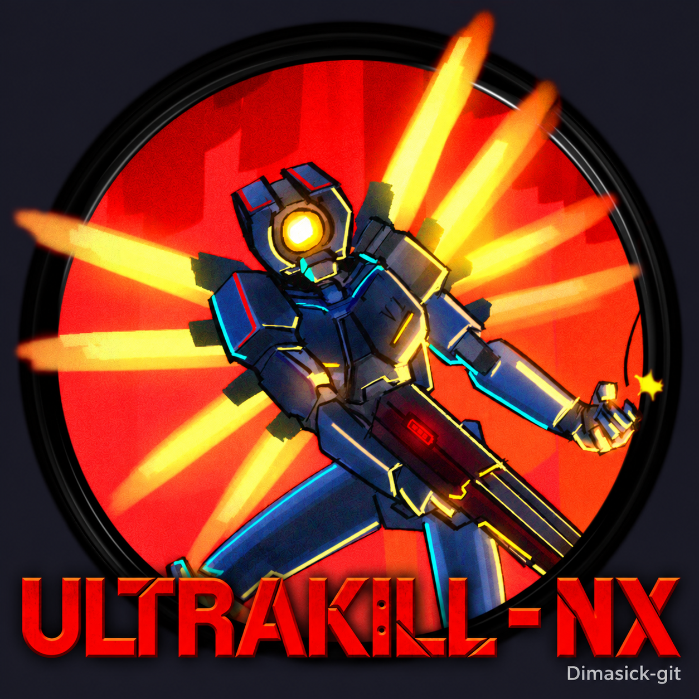
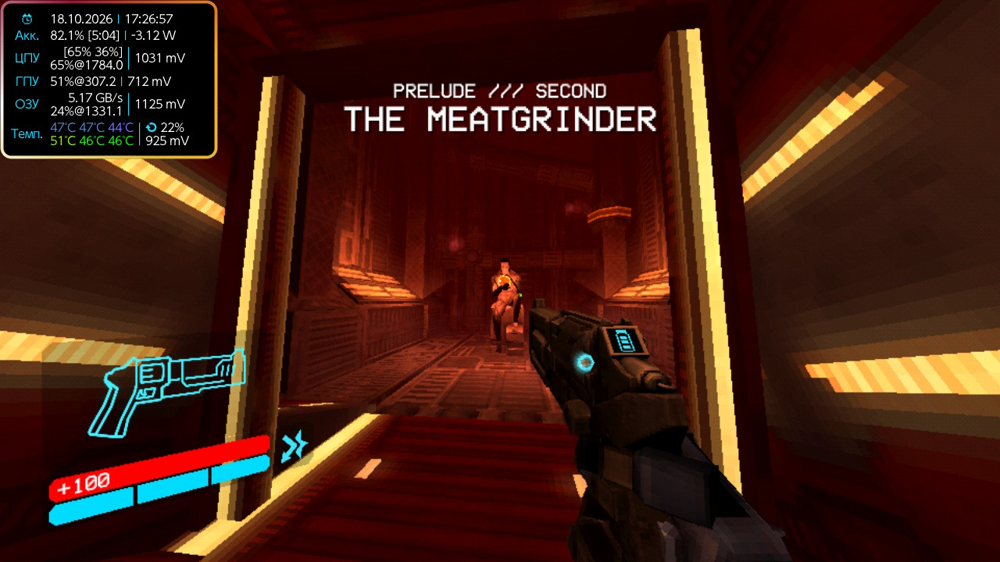
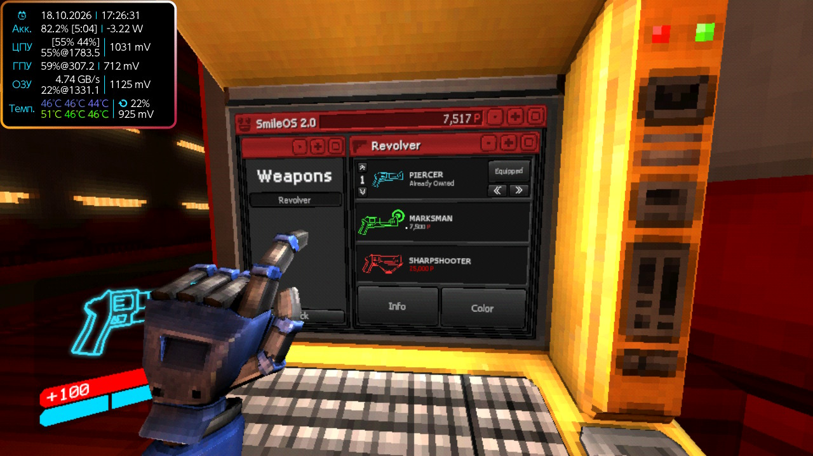
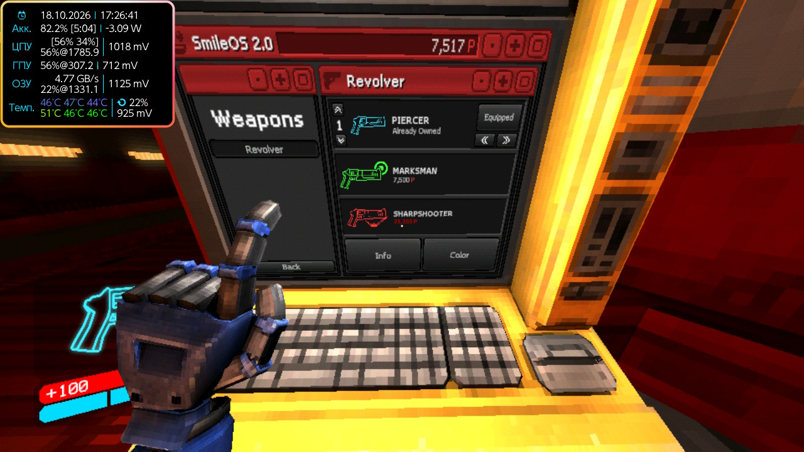

<p align="center"></p>
<h1 align="center">ULTRAKILL — NX</h1>
<p align="center">Неофициальный homebrew-порт ULTRAKILL на Nintendo Switch.<br>Порт и интеграция — <a href="https://github.com/Dimasick-git">Dimasick-git</a>.</p>
<p align="center"><a href="https://github.com/Dimasick-git/ULTRAKILL-NX/releases/tag/r1">Скачать</a> · <a href="docs/BUILD.md">Сборка</a> · <a href="docs/ARCHITECTURE.md">Устройство порта</a> · <a href="https://github.com/Dimasick-git/ULTRAKILL-NX/issues/new/choose">Сообщить о баге</a></p>



Работают запуск с HOME, управление, гироскоп, звук и видеоролики. FSR1 увеличивает
игровую картинку с 960×540 до 1280×720. В меню физическая **A подтверждает, B отменяет**.

Актуальный комплект **r1 / build r28**. Это рабочий порт в разработке: полное
прохождение ещё не проверено. Цель — 60 FPS; тяжёлые сцены пока работают медленнее.
В тяжёлых боях Лимбо в последнем прогоне r28 зафиксированы 10–15 FPS;
обычные участки могут держать 60. Переход 1-1 → 1-2 с r28 пройден без зависания.
Эти наблюдения не являются сравнительным тестом прироста. Скриншоты выше и ниже
сняты с разгоном; частоты видны в оверлее.

Исходники **r29 проходят локальную проверку**: CPU-профиль 60 Гц/480p,
восстановление NULL-списков оружия и прямой мост SaltyNX. [Профиль и проверка](docs/PERFORMANCE-r29.md),
[поддержка SaltyNX](docs/SALTYNX.md). Публичный комплект ниже остаётся r28 до проверки на устройстве.

## Скачать и установить

Скачай **оба** файла из [релиза r1](https://github.com/Dimasick-git/ULTRAKILL-NX/releases/tag/r1):

- [ULTRAKILL-NX_PART_1.zip](https://github.com/Dimasick-git/ULTRAKILL-NX/releases/download/r1/ULTRAKILL-NX_PART_1.zip)
- [ULTRAKILL-NX_PART_2.zip](https://github.com/Dimasick-git/ULTRAKILL-NX/releases/download/r1/ULTRAKILL-NX_PART_2.zip)

Это самостоятельные ZIP с разными файлами игры. Распакуй **оба в одну папку**,
объединяя `switch`. Порядок не важен, склеивать архивы не нужно. Каждый архив меньше
2 ГиБ. SHA-256 архивов указан в релизе, хеши файлов — внутри `SHA256SUMS.txt`.
Кнопка GitHub **Source code** скачивает исходники порта.

1. Нужен Switch с Atmosphère и DBI.
2. Скопируй полученную папку `switch` в корень microSD.
3. Установи `ULTRAKILL_NX_forwarder.nsp` через DBI.
4. Безопасно извлеки карту и запускай игру с HOME: требуется память полноценного приложения.

```text
microSD/switch/ultrakill/
├── ultrakill_nx.nro
├── config.txt
├── offsets.ini
├── libil2cpp.so
├── libmain.so
├── libunity.so
├── licenses/
└── assets/
```

При обновлении сохрани `Saves`, `Preferences`, `LocalPrefs.json` и свой `config.txt`.
Замени файлы сборки, затем верни личные настройки. Удали служебную папку `il2cpp/`
внутри папки игры: движок создаст кэш заново. Нельзя смешивать библиотеку, offsets
и метаданные разных сборок. Уже установленный форвардер переустанавливать не требуется.
Первый запуск и загрузки уровней могут быть долгими.

## Управление и графика

| Кнопка | Действие |
| :-- | :-- |
| Левый / правый стик | Движение / обзор |
| ZR / ZL | Основной / дополнительный огонь |
| B (нижняя) | Прыжок |
| + | Пауза |
| A / B в меню | Подтвердить / назад |
| Гироскоп | Доводка прицела |

Остальные привязки доступны в игре. Игровые действия позиционные;
роли подтверждения и отмены соответствуют Nintendo Switch.

В `switch/ultrakill/config.txt` используется формат `имя значение`, без `=`:

```text
gyro 1
gyro_sens 2
gyro_invert_x 1
gyro_invert_y 1
performance_mode 1
render_height 540
fsr 1
fsr_sharpness 0.5
```

`fsr 0` отключает FSR. Для сравнения на тяжёлом участке можно выбрать
`render_height 480` при `fsr 1`. FSR масштабирует также HUD и не устраняет
ограничения главного потока CPU. [Устройство и проверка FSR](docs/FSR.md).

## Кадры с консоли

| Терминал | Оружие |
| :--: | :--: |
|  |  |

## Состояние разработки

- Исправлены направления гироскопа, ложные нажатия от курков и вылет обходчика стеков.
- GC включён с r25; остановка потоков и корни регистров реализованы через Horizon.
- FSR EASU/RCAS проверен на GPU в редакторе и при выводе на Switch.
- Реальные маски CPU и профиль потоков доступны в журнале. Процессу разрешены три ядра.
- Добавлена защита от NULL при загрузке данных Umbra на переходе Лимбо 1-1 → 1-2.
- Повторяющиеся исключения агрегируются в журнале r27, полный счётчик сохраняется.

Остаются просадки FPS, паузы загрузки и повторяющийся `NullReferenceException`
без полезного стека. Агрегация журнала не исправляет его источник. Длительные
перезапуски и все уровни ещё требуют проверки. [Проверки и ограничения](docs/TESTING.md),
[изменения](CHANGELOG.md), [память и GC](docs/GC-r23.md).

## Участие

[Issue](https://github.com/Dimasick-git/ULTRAKILL-NX/issues/new/choose) должен содержать
номер сборки, уровень и шаги повторения, модель Switch, частоты CPU/GPU/RAM и тайминги,
`debug.log` и свежий crash report, если был вылет. Для замеров FPS нужен одинаковый
маршрут и настройки. Порядок работы с изменениями и релизами — в [CONTRIBUTING](CONTRIBUTING.md).

## Авторы

**Dimasick-git** — порт и интеграция. **[Ryazhenka-helper-01 / Zeropaxy](https://github.com/Ryazhenka-helper-01)** — главный тестер, скриншоты и видео.

ULTRAKILL — Arsi “Hakita” Patala / New Blood Interactive. Порт не связан с Nintendo
или авторами оригинальной игры. Поддержите оригинальную ULTRAKILL.

Основа загрузчика: ChanseyIsTheBest, fgsfds и TheOfficialFloW. Используются
nx-hbloader, devkitPro/libnx, Mesa/nouveau, SDL2, libjpeg-turbo, Boehm GC и AMD FSR1.
[Все авторы и лицензии](CREDITS.md).
