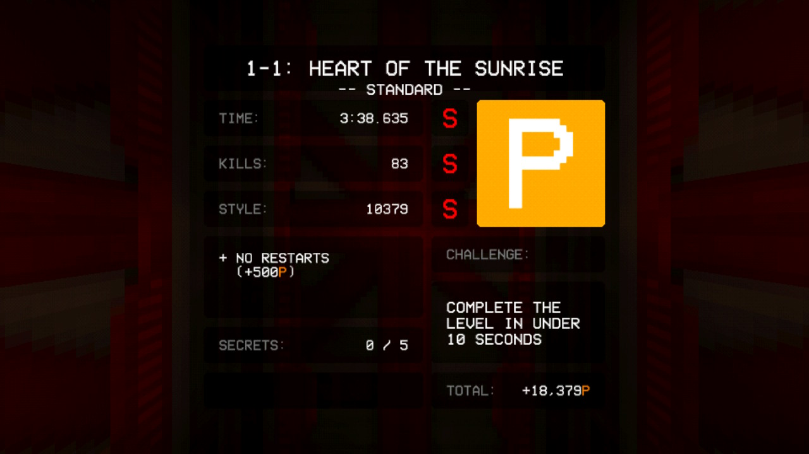
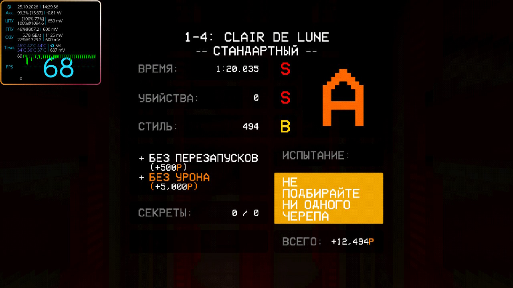

<p align="center">
  
</p>

<h1 align="center">ULTRAKILL — NX</h1>

<p align="center">Неофициальный порт ULTRAKILL для Nintendo Switch.<br>Порт и интеграция — <a href="https://github.com/Dimasick-git">Dimasick-git</a>.</p>

<p align="center">
  <a href="https://github.com/Dimasick-git/ULTRAKILL-NX/releases/tag/v2.0.0">Скачать 2.0.0</a> ·
  <a href="docs/INSTALL_RU.txt">Установка</a> ·
  <a href="CHANGELOG.md">Изменения</a> ·
  <a href="https://t.me/RYAZHENKACFW">Telegram</a>
</p>


## Версия 2.0.0

Комплект для microSD: игра, звук, ролики, переводы и форвардер для запуска с HOME. Техническая основа выпуска — сборка **r93**.

- **Управление Switch.** Подсказки с кнопками консоли, A — подтвердить, B — назад в меню.
- **Гироскоп.** Включение, чувствительность и инверсия осей в настройках управления.
- **Сенсорные меню и терминалы.** Касания, ползунки, списки и экранная клавиатура.
- **14 языков.** Переключение в общих настройках; новая установка начинается на английском.
- **FSR 1.** Масштабирование изображения и настройка резкости в Video → Render. Генерации кадров в этом выпуске нет.
- **Лимит FPS.** 30 / 60 / 120 / 144 / 240 / 288; None — до 1000. Применение без перезапуска уровня. Для нового профиля выбран лимит 60.

Лимит задаёт потолок кадров, а не гарантированную производительность. В тяжёлых боях остаются просадки и статтеры. Последние изменения r93 проверены на ПК; их эффект на Switch ещё не измерен. Полное прохождение и стабильные 60 FPS во всей игре **не подтверждены**.

Русская таблица содержит 2395 подготовленных строк. Остальные 12 переводов — машинные черновики с частичной вычиткой. [Состояние переводов](docs/LOCALIZATION.md).

## Установка

Нужны Nintendo Switch с Atmosphère, DBI и свободное место на microSD.

1. Скачай **оба** архива со [страницы релиза](https://github.com/Dimasick-git/ULTRAKILL-NX/releases/tag/v2.0.0):

   ```text
   ULTRAKILL-NX_PART_1.zip
   ULTRAKILL-NX_PART_2.zip
   ```

2. Распакуй содержимое обоих ZIP **в одну папку**, объединяя каталоги. Это два самостоятельных архива: склеивать файлы не нужно, порядок распаковки не важен.
3. Скопируй папку `switch` в корень microSD. Для первой установки SaltyNX также нужны папки `atmosphere` и `SaltySD` из комплекта; существующий настроенный SaltyNX без необходимости не заменяй.
4. Установи `ULTRAKILL_NX_forwarder.nsp` из комплекта через DBI и запускай игру с HOME. Этот маленький NSP запускает файлы с SD; игровые данные находятся в папке `switch/ultrakill`.
5. После первой установки или обновления SaltyNX полностью перезагрузи консоль в Atmosphère.

При обновлении сохраняй `Saves`, `Preferences` и `config.txt` в `switch/ultrakill`. Комплект их не содержит и не заменяет. Если прежде стоял полный NSP, установи форвардер из этого комплекта: иначе HOME может продолжать запускать встроенную старую сборку.

**`Languages_UK.zip`** — отдельное обновление 13 таблиц перевода для версии 2.0.0. Языки уже включены в два основных архива; скачивать его для полной установки не требуется. Английский встроен в игру.

[Подробная установка и обновление](docs/INSTALL_RU.txt).

## В игре

| Терминал | Прохождение 0-2 |
| :--: | :--: |
|  |  |

| 1-1 — P-ранг | 1-4 — русский интерфейс |
| :--: | :--: |
|  |  |

Скриншоты сделаны на Nintendo Switch во время тестирования порта.

## Управление и настройки

| Кнопка | Действие |
| :-- | :-- |
| Левый / правый стик | Движение / обзор |
| ZR / ZL | Основной / дополнительный огонь |
| B | Прыжок |
| + | Пауза |
| A / B в меню | Подтвердить / назад |

Остальные действия переназначаются в игре. Гироскоп находится в **Controls**, язык — в **General → Language**, рендер и FSR 1 — в **Video → Render**. Пользовательские настройки сохраняются при обновлении.

## Сообщить об ошибке

В [issue](https://github.com/Dimasick-git/ULTRAKILL-NX/issues/new/choose) укажи версию порта, модель Switch, уровень и шаги воспроизведения. Приложи `switch/ultrakill/debug.log`; после вылета — свежий отчёт из `atmosphere/crash_reports`. Для проблем с SaltyNX также нужен `SaltySD/saltynx.log`.

Укажи частоты CPU/GPU/RAM и изменённые настройки рендера. [Что и как проверять](docs/TESTING.md).

## Исходники

Порт использует Unity / IL2CPP для Android ARM64, загрузчик Horizon и графический стек OpenGL ES / Mesa / nouveau. В репозитории находятся код порта и инструменты; Unity-проект игры, игровые библиотеки и консольные ключи сюда не входят.

[Сборка](docs/BUILD.md) · [Архитектура](docs/ARCHITECTURE.md) · [SaltyNX](docs/SALTYNX.md) · [Участие в разработке](CONTRIBUTING.md)

## Авторы

**[Dimasick-git](https://github.com/Dimasick-git)** — порт и интеграция.

**[Ryazhenka-helper-01 / Zeropaxy](https://github.com/Ryazhenka-helper-01)** — главный тестер, скриншоты и видео.

Оригинальная ULTRAKILL — Arsi “Hakita” Patala и New Blood Interactive. [Игра в Steam](https://store.steampowered.com/app/1229490/ULTRAKILL/).

[Все авторы и зависимости](CREDITS.md) · [Лицензии и правовая информация](docs/LEGAL.md)
