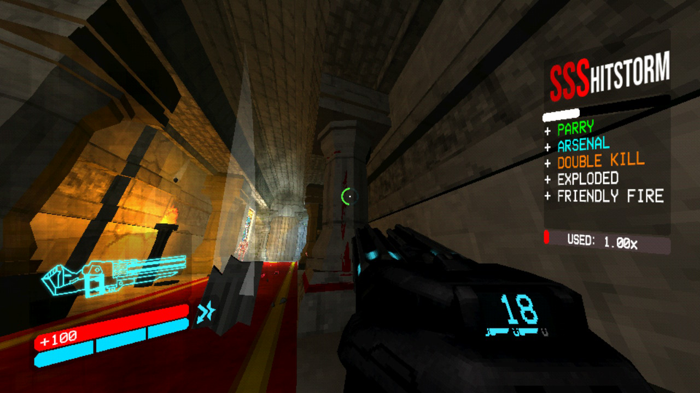
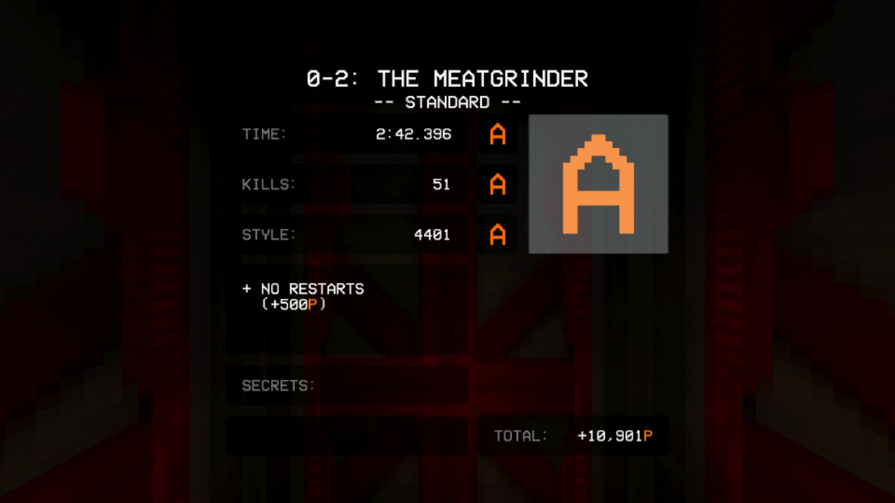

<p align="center">
  
</p>

<h1 align="center">ULTRAKILL — NX</h1>

<p align="center">
  Неофициальный homebrew-порт <strong>ULTRAKILL</strong> для Nintendo Switch.
</p>

<p align="center">
  <a href="https://github.com/Dimasick-git/ULTRAKILL-NX/releases">Релизы</a> ·
  <a href="https://store.steampowered.com/app/1229490/ULTRAKILL/">Оригинал в Steam</a> ·
  <a href="docs/INSTALL_RU.txt">Установка</a> ·
  <a href="docs/BUILD.md">Сборка</a> ·
  <a href="docs/ARCHITECTURE.md">Архитектура</a> ·
  <a href="https://github.com/Dimasick-git/ULTRAKILL-NX/issues/new/choose">Сообщить о проблеме</a>
</p>


## О проекте

ULTRAKILL — NX переносит Android-сборку Unity/IL2CPP на Nintendo Switch. Порт включает загрузчик для Horizon, совместимость с Android/JNI-вызовами, собственный слой ввода, гироскоп, видео, звук, диагностику и интеграцию с SaltyNX.

В Git находятся код порта, инструменты подготовки и документация. Unity-проект игры, реверс-инженерный код ULTRAKILL и консольные ключи сюда не входят. Состав релизных архивов и лицензии описаны в [правовой информации](docs/LEGAL.md).

### Что уже работает

- запуск с HOME через отдельный forwarder;
- управление Nintendo Switch и гироскопическая доводка прицела;
- звук и подготовленные видеоролики;
- рендер через OpenGL ES 3 / Mesa / nouveau;
- FSR1 EASU + RCAS для вывода 540p в 720p;
- работа с GC, диагностикой CPU и телеметрией кадров;
- переходы между проверенными сценами без закрытия приложения;
- SaltyNX-мост и режим ускорения загрузок в актуальной сборке.

### Текущий статус

> **Текущий релиз:** [r1 / build r32](https://github.com/Dimasick-git/ULTRAKILL-NX/releases/tag/r1)

Это рабочая тестовая сборка, а не заявление о полном прохождении игры. В лёгких сценах возможны 60 FPS, но в тяжёлых боях остаются просадки, паузы загрузки и отдельные ошибки совместимости Unity.

Новые функции r32 — управление масштабом через SaltyNX/FSR-NX, чтение частоты дисплея и FastLoad — ещё проверяются на Switch. Стабильные 60 FPS во всей игре пока **не подтверждены**. См. [проверки](docs/TESTING.md) и [журнал изменений](CHANGELOG.md).

> **Тестовая среда:** аппаратные результаты получены на конкретной конфигурации [Ryzhenka + Ryazha-clk](docs/TEST_ENVIRONMENT.md). Это не типовая или гарантированно воспроизводимая настройка на любой Switch; Ryazha-clk не требуется для запуска порта.

### Локальная тестовая сборка r34

Подготовлен полный NSP: игровые данные находятся внутри установленного приложения,
сохранения и настройки — на SD. Добавлены касания в меню и терминалах, перетаскивание
ползунков и списков, экранная клавиатура и панель параметров порта. Подсказки используют
кнопки Switch и текущие привязки действий. [Установка полного NSP](docs/INSTALL_NSP_RU.md).

В r34 исправлен состав установщика: восстановлены стартовая сцена и ресурсы игры
после чёрного экрана в r33. Заставка Unity отключена в игровых настройках.
Проверки данных и контейнера на ПК пройдены; запуск r34 на консоли ещё не подтверждён.
Публичные архивы r1 пока содержат r32.

## Скриншоты

| Игровой процесс | Результат прохождения 0-2 |
| :--: | :--: |
|  |  |

Кадры сделаны на Nintendo Switch во время тестирования порта.

## Установка

### Требования

- Nintendo Switch с Atmosphère;
- DBI для установки forwarder NSP;
- microSD с достаточным свободным местом;
- файлы игры из релизного комплекта или собственная копия для сборки из исходников;
- SaltyNX 2.1.3 для функций, использующих мост SaltyNX.

> **О совместимости:** порт тестировался на кастомном ПО [Ryzhenka](https://github.com/Dimasick-git/Ryzhenka). На других кастомных прошивках, сборках Atmosphère и наборах системных модулей совместимость не гарантируется — проверяйте её отдельно. Автор не отвечает за повреждение системы, данных или консоли при запуске на неподдерживаемом окружении.

### Установка полной сборки

1. Открой страницу [релиза r1](https://github.com/Dimasick-git/ULTRAKILL-NX/releases/tag/r1) и скачай оба архива:
   - `ULTRAKILL-NX_PART_1.zip`;
   - `ULTRAKILL-NX_PART_2.zip`.
2. Распакуй оба ZIP в одну временную папку с объединением каталогов. Архивы независимые, склеивать их не нужно.
3. Скопируй каталоги `switch`, `atmosphere` и `SaltySD` в корень microSD.
4. Установи `ULTRAKILL_NX_forwarder.nsp` через DBI.
5. После первой установки или обновления SaltyNX полностью перезагрузи Switch в Atmosphère.
6. Запусти ULTRAKILL с HOME. Для такого запуска используется память полноценного приложения.

После распаковки основные файлы игры находятся здесь:

```text
microSD/
├── atmosphere/
├── SaltySD/
└── switch/
    └── ultrakill/
        ├── ultrakill_nx.nro
        ├── config.txt
        ├── offsets.ini
        ├── libil2cpp.so
        ├── libmain.so
        ├── libunity.so
        ├── licenses/
        └── assets/
```

SHA-256 архивов указан на странице релиза. Файл `SHA256SUMS.txt` содержит хеши файлов полного комплекта. Проверь хеши после распаковки обоих архивов.

Полная пошаговая инструкция, обновление старой установки и сохранение пользовательских данных описаны в [INSTALL_RU.txt](docs/INSTALL_RU.txt).

## Настройки

Файл конфигурации находится по адресу `sdmc:/switch/ultrakill/config.txt`. Одна настройка на строку, имя и значение разделены пробелом. Значения по умолчанию подходят для первого запуска.

<details>
<summary>Показать пример config.txt и параметры</summary>

```text
gyro 1
gyro_sens 2
gyro_invert_x 1
gyro_invert_y 1
performance_mode 1
render_height 540
fsr 1
fsr_sharpness 0.5
saltynx 1
loading_boost 1
```

Главные параметры:

- `gyro 0/1` — включить или отключить гироскоп;
- `gyro_sens` — чувствительность гироскопа;
- `gyro_invert_x`, `gyro_invert_y` — инверсия осей;
- `render_height` — высота внутреннего рендера, допустимый диапазон — 180–720;
- `fsr 0/1` — отключить или включить FSR1;
- `fsr_sharpness` — сила RCAS sharpening;
- `saltynx 0/1` — отключить или включить мост SaltyNX;
- `loading_boost 0/1` — отключить или включить FastLoad.

Для начала рекомендуется оставить `render_height 540` и `fsr 1`. Уменьшение высоты рендера снижает нагрузку на GPU, но ухудшает качество изображения. FSR масштабирует игровой кадр вместе с HUD и не устраняет ограничения главного потока CPU.

</details>

## Управление

В игре используются стандартные действия ULTRAKILL, адаптированные под контроллер Switch.

| Управление | Действие |
| :-- | :-- |
| Левый стик | Движение |
| Правый стик | Обзор |
| ZR / ZL | Основной / дополнительный огонь |
| B | Прыжок |
| + | Пауза |
| Гироскоп | Доводка прицела |
| A в меню | Подтвердить |
| B в меню | Назад / отменить |

Остальные игровые действия настраиваются штатными средствами игры. Роли кнопок в меню соответствуют Nintendo Switch: физическая `A` подтверждает, физическая `B` возвращает назад.

## Архитектура

Порт состоит из нескольких независимых слоёв:

```text
forwarder/              запуск NRO из HOME
loader/source/          загрузчик, Horizon, Android/JNI, окно и GLES
loader/source/nx_gc.c   интеграция Boehm GC с потоками Horizon
unity/Assets/NxPort/    ввод, гироскоп, видео и FSR-композиция
tools/                  подготовка данных, шейдеров, offsets и упаковка
docs/                   сборка, тестирование и технические заметки
```

Движок и IL2CPP собираются для Android ARM64. Загрузчик предоставляет необходимые платформенные вызовы на Horizon. Графика проходит через GLES/Mesa/nouveau. Подробнее о границах между компонентами — в [ARCHITECTURE.md](docs/ARCHITECTURE.md).

## Сборка из исходников

Сборка из исходников требует собственной копии игры, Unity **2022.3.29f1**, Android Build Support, NDK, OpenJDK и окружения devkitPro. Готовые игровые библиотеки и консольные ключи в репозитории отсутствуют.

Быстрый путь для загрузчика:

```sh
make -C loader -j4
```

Подготовка Unity/IL2CPP, данных, шейдеров, runtime-патчей и forwarder описана в [BUILD.md](docs/BUILD.md). Для сборки нужны совместимые `NRO`, `libil2cpp.so`, `offsets.ini`, metadata и shader bundle; файлы разных сборок смешивать нельзя.

## Диагностика и сообщения о проблемах

### Где найти логи

После воспроизведения проблемы полностью закрой игру и открой microSD на компьютере. Нужные файлы находятся по этим путям:

```text
sdmc:/switch/ultrakill/debug.log
sdmc:/SaltySD/saltynx.log
sdmc:/atmosphere/crash_reports/
```

Скопируй `debug.log` и `SaltySD/saltynx.log` **до следующего запуска**: журнал игры может быть перезаписан. Если произошёл вылет, приложи самый свежий файл из `atmosphere/crash_reports/`. Если используешь FTP или MTP вместо снятия microSD, пути остаются теми же — ищи их от корня карты памяти.

Перед созданием issue:

1. проверь, что файлы относятся к одной и той же сборке;
2. полностью перезагрузи Switch после обновления SaltyNX;
3. повтори проблему на чистой конфигурации, если это возможно;
4. приложи найденные логи и свежий crash report;
5. запиши модель Switch, версию Atmosphère, HOS, частоты CPU/GPU/RAM, уровень, настройки рендера и точные шаги воспроизведения.

Не прикладывай к issue игровые библиотеки, дампы с личными данными, консольные ключи или полные коммерческие архивы игры. Вопросы по сборке и воспроизводимые ошибки публикуй в [Issue tracker](https://github.com/Dimasick-git/ULTRAKILL-NX/issues), указывая в заголовке `[question]` или `[bug]`.

## Документация

- [Установка и обновление](docs/INSTALL_RU.txt)
- [Сборка из исходников](docs/BUILD.md)
- [Архитектура](docs/ARCHITECTURE.md)
- [FSR и ограничения графического backend](docs/FSR.md)
- [SaltyNX](docs/SALTYNX.md)
- [FastLoad](docs/LOADING.md)
- [Проверки и ограничения](docs/TESTING.md)
- [Тестовая среда и применимость результатов](docs/TEST_ENVIRONMENT.md)
- [Память и GC](docs/GC-r23.md)
- [Шаблон релизных заметок](docs/RELEASE_TEMPLATE.md)
- [История изменений](CHANGELOG.md)

## Участие

Перед изменениями прочитай [CONTRIBUTING.md](CONTRIBUTING.md). В pull request укажи, что изменилось и как это проверялось. Изменения графики, памяти, ввода, загрузок и SaltyNX проверяй на Switch.

## Авторы и лицензии

- **Dimasick-git** — порт и интеграция.
- **[Ryazhenka-helper-01 / Zeropaxy](https://github.com/Ryazhenka-helper-01)** — тестирование, скриншоты и видео.
- Благодарности авторам загрузчика, nx-hbloader, devkitPro/libnx, Mesa/nouveau, SDL2, libjpeg-turbo, Boehm GC и AMD FSR1 перечислены в [CREDITS.md](CREDITS.md).

ULTRAKILL создан Arsi “Hakita” Patala и New Blood Interactive. [Официальная версия ULTRAKILL в Steam](https://store.steampowered.com/app/1229490/ULTRAKILL/) — источник оригинальной игры, из которой подготавливаются данные для порта. Этот проект не связан с Nintendo, New Blood Interactive или авторами оригинальной игры. Не распространяйте оригинальные игровые данные и поддерживайте официальную версию ULTRAKILL.

Лицензии компонентов и сведения об оригинальной игре: [CREDITS.md](CREDITS.md), [LICENSE.md](LICENSE.md) и [LEGAL.md](docs/LEGAL.md).
